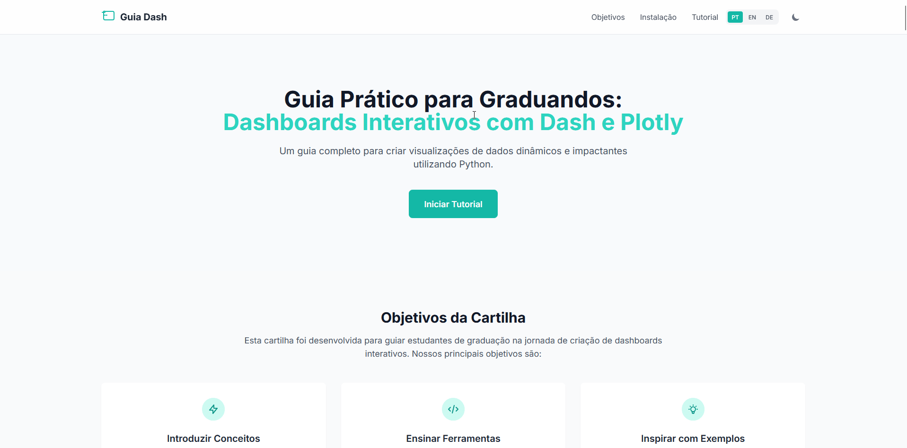

# Interaktive Dashboards mit Dash und Plotly

[](https://python.org)
[](https://dash.plotly.com/)
[](https://plotly.com/)
[](https://docs.astral.sh/uv/)
[](LICENSE)
[](https://joaosnet.github.io/cartilha_dash/)

[English](README.md) | [Português](README.pt.md) | [Deutsch](README.de.md)

---

Interaktiver Web-Leitfaden und didaktischer Leitfaden für Studierende zur Erstellung analytischer Dashboards mit Python, Dash, Plotly, Dash Mantine Components und AG Grid.



## Überblick

Der Leitfaden führt Studierende durch die Transformation klinischer Rohdaten (Echokardiogramm-Datensätze) in ein vollständiges Analyse-Dashboard. Statt eines monolithischen Codeblocks gliedert das Curriculum die Entwicklung in neun aufeinander aufbauende Stufen: Datenaufnahme, visuelle Komponentenhierarchien, responsive Layouts, Umschaltung zwischen hellem und dunklem Design sowie reaktive Callbacks.

Live-Bereitstellung: [joaosnet.github.io/cartilha_dash](https://joaosnet.github.io/cartilha_dash/)

## Lehrplan

| Stufe | Thema | Schwerpunkt | Kernkomponenten |
| :--- | :--- | :--- | :--- |
| **01** | Datenerfassung | Bezug klinischer Datensätze über Kaggle | CSV-Dateistruktur, Merkmalsspalten |
| **02** | Einlesen & Bereinigung | Vorbereitung tabellarischer Daten mit Pandas | `pandas.read_csv`, Umgang mit fehlenden Werten |
| **03** | Basis-Layout & Header | Anwendungscontainer und Header-Struktur | `dmc.AppShell`, `dmc.AppShellHeader` |
| **04** | Erste Visualisierung | Univariate Verteilungsdiagramme | `px.histogram`, `dcc.Graph` |
| **05** | Responsives Grid | Mehrspaltiges Analyse-Kartenlayout | `dmc.Grid`, `dmc.GridCol`, `dmc.Card` |
| **06** | Interaktive Datentabelle | Tabellarische Datenexploration mit Sortierung und Filtern | `dash_ag_grid.AgGrid` |
| **07** | Design-Umschaltung | Hell- und Dunkelmodus mit lokaler Persistenz | `dmc.Switch`, `dash_iconify` |
| **08** | Reaktive Callbacks | Ereignisgesteuerte Benutzerinteraktion und Zustandsaktualisierungen | `@app.callback`, `Input`, `Output` |
| **09** | Integriertes Dashboard | Vollständige und produktionsreife Anwendungsarchitektur | Integrierte Gesamtanwendung |

## Web-Leitfaden lokal ausführen

Das Referenzhandbuch ist eine statische Webanwendung ohne Backend-Abhängigkeiten.

```bash
# Repository klonen
git clone https://github.com/joaosnet/cartilha_dash.git
cd cartilha_dash

# Über einen statischen HTTP-Server bereitstellen
python -m http.server 8000
# oder
npx serve .
```

Öffnen Sie `http://localhost:8000` im Browser.

## Dashboard mit uv reproduzieren

Um die im Leitfaden behandelte Python-Dash-Anwendung zu erstellen und auszuführen, richten Sie die Umgebung mit `uv` ein:

```bash
# Neues Projektverzeichnis initialisieren
uv init dashboard-echokardiogramm
cd dashboard-echokardiogramm

# Benötigte Abhängigkeiten hinzufügen
uv add dash pandas plotly dash-mantine-components dash-iconify dash-ag-grid

# Anwendung mit automatischem Neuladen ausführen
uv run python app.py
```

## Technologie-Stack

| Ebene | Technologie | Rolle |
| :--- | :--- | :--- |
| **Web-Oberfläche** | HTML5, Tailwind CSS, Highlight.js | Interaktive Leseumgebung mit Sprachauswahl |
| **Datenverarbeitung** | Python 3.10+, Pandas | CSV-Import, Datenbereinigung und statistische Aggregationen |
| **Visualisierung** | Plotly Express | Histogramme, Balkendiagramme, Streudiagramme und Boxplots |
| **Dashboard-Komponenten** | Dash Mantine Components (DMC) | Grid-System, AppShell, Karten, Schalter und Icons |
| **Datentabelle** | Dash AG Grid | Hochperformante interaktive Sortierung, Filterung und Paginierung |
| **Paketverwaltung** | uv (Astral) | Schnelle Erstellung virtueller Umgebungen und deterministische Auflösung |

## Lizenz

Veröffentlicht unter der [MIT-Lizenz](LICENSE).
