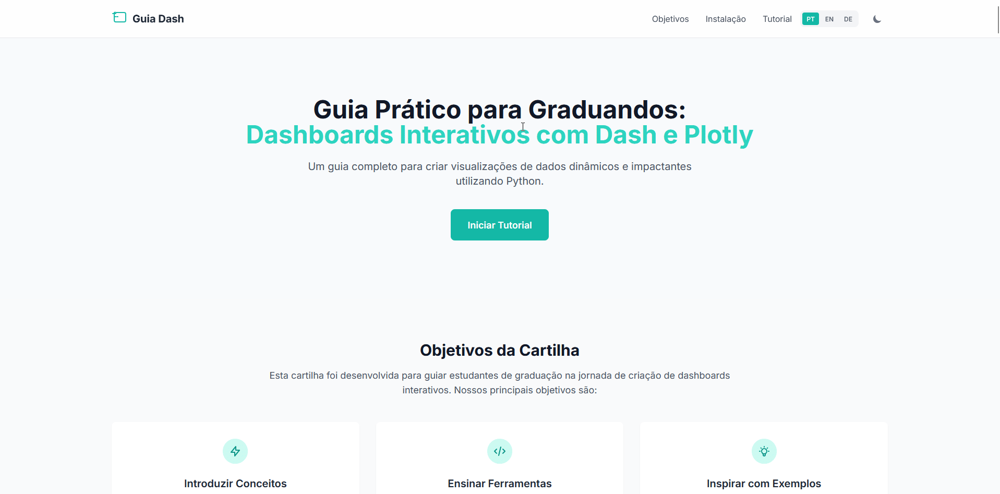

# Interactive Dashboards with Dash & Plotly

[](https://python.org)
[](https://dash.plotly.com/)
[](https://plotly.com/)
[](https://docs.astral.sh/uv/)
[](LICENSE)
[](https://joaosnet.github.io/cartilha_dash/)

[English](README.md) | [Português](README.pt.md) | [Deutsch](README.de.md)

---

Interactive web guide and pedagogical roadmap designed for undergraduate students building analytical dashboards with Python, Dash, Plotly, Dash Mantine Components, and AG Grid.



## Overview

The guide teaches students how to transform tabular health data (echocardiogram records) into a production-ready analytical dashboard. Instead of presenting a monolithic code file, the curriculum breaks down dashboard engineering into nine progressive stages, introducing data pipelines, visual component hierarchies, responsive layouts, client-side theme switching, and stateful callbacks.

Live deployment: [joaosnet.github.io/cartilha_dash](https://joaosnet.github.io/cartilha_dash/)

## Curriculum

| Stage | Topic | Focus | Core Components |
| :--- | :--- | :--- | :--- |
| **01** | Data Acquisition | Sourcing clinical records from Kaggle | CSV file structure, feature columns |
| **02** | Ingestion & Cleaning | Reading and preparing tabular data | `pandas.read_csv`, null value handling |
| **03** | Core Shell & Header | Application container and header structure | `dmc.AppShell`, `dmc.AppShellHeader` |
| **04** | First Visualization | Univariate distribution charting | `px.histogram`, `dcc.Graph` |
| **05** | Responsive Grid | Multi-column analytical card layout | `dmc.Grid`, `dmc.GridCol`, `dmc.Card` |
| **06** | Interactive Data Table | High-density tabular browsing with sorting and filters | `dash_ag_grid.AgGrid` |
| **07** | Theme Switching | Dark and light mode toggle with local persistence | `dmc.Switch`, `dash_iconify` |
| **08** | Reactive Callbacks | Dynamic user interaction and state updates | `@app.callback`, `Input`, `Output` |
| **09** | Integrated Dashboard | Complete unified clinical dashboard architecture | Monolithic production-ready application |

## Running the Web Guide Locally

The reference handbook is a static web application with zero backend dependencies.

```bash
# Clone repository
git clone https://github.com/joaosnet/cartilha_dash.git
cd cartilha_dash

# Serve via any static HTTP server
python -m http.server 8000
# or
npx serve .
```

Open `http://localhost:8000` in your browser.

## Reproducing the Dashboard with uv

To build and run the Python Dash application covered in the guide, configure the environment with `uv`:

```bash
# Initialize a new project directory
uv init echocardiogram-dashboard
cd echocardiogram-dashboard

# Add runtime dependencies
uv add dash pandas plotly dash-mantine-components dash-iconify dash-ag-grid

# Run the application with hot reload
uv run python app.py
```

## Tech Stack

| Layer | Technology | Role |
| :--- | :--- | :--- |
| **Guide Web Interface** | HTML5, Tailwind CSS, Highlight.js | Interactive reading environment with multi-language switching |
| **Data Processing** | Python 3.10+, Pandas | CSV ingestion, dataset formatting, statistical aggregations |
| **Visualization** | Plotly Express | Histograms, bar charts, scatter plots, and box plots |
| **Dashboard UI** | Dash Mantine Components (DMC) | Grid system, AppShell, cards, switch controls, and icons |
| **Data Grid** | Dash AG Grid | Enterprise-grade interactive sorting, filtering, and pagination |
| **Package Management** | uv (Astral) | Fast virtual environment creation and deterministic dependency resolution |

## License

Distributed under the [MIT License](LICENSE).
