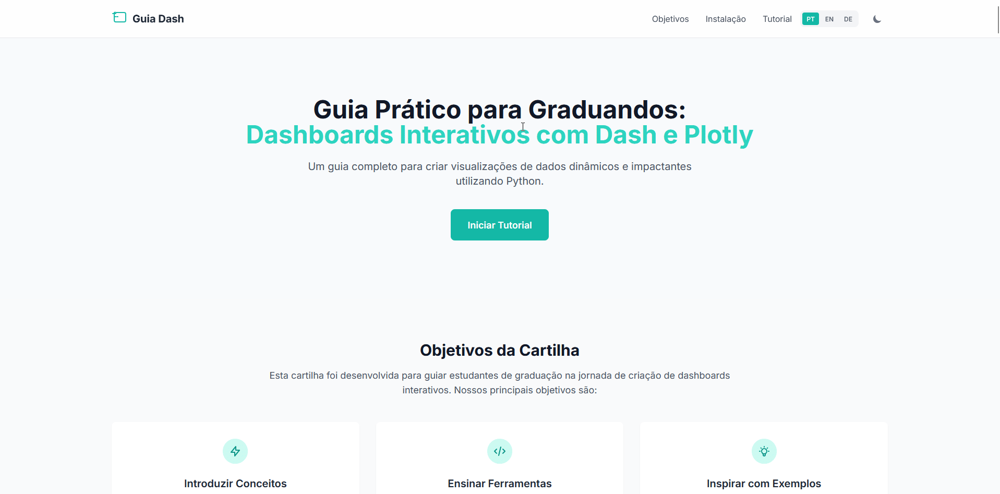

# Dashboards Interativos com Dash e Plotly

[](https://python.org)
[](https://dash.plotly.com/)
[](https://plotly.com/)
[](https://docs.astral.sh/uv/)
[](LICENSE)
[](https://joaosnet.github.io/cartilha_dash/)

[English](README.md) | [Português](README.pt.md) | [Deutsch](README.de.md)

---

Guia web interativo e roteiro pedagógico desenvolvido para estudantes de graduação construírem dashboards analíticos utilizando Python, Dash, Plotly, Dash Mantine Components e AG Grid.



## Visão Geral

A cartilha orienta os estudantes na transformação de dados brutos de saúde (registros de ecocardiograma) em um dashboard analítico completo. Em vez de apresentar um arquivo de código monolítico desde o início, o conteúdo divide a construção em nove etapas progressivas, cobrindo ingestão de dados, hierarquia de componentes visuais, layouts responsivos, alternância de tema claro/escuro e callbacks reativos.

Demonstração online: [joaosnet.github.io/cartilha_dash](https://joaosnet.github.io/cartilha_dash/)

## Conteúdo Programático

| Etapa | Tópico | Foco | Componentes Principais |
| :--- | :--- | :--- | :--- |
| **01** | Obtenção dos Dados | Download do conjunto de dados clínicos no Kaggle | Estrutura de arquivos CSV, colunas e atributos |
| **02** | Leitura e Limpeza | Leitura e tratamento inicial com Pandas | `pandas.read_csv`, tratamento de valores nulos |
| **03** | Estrutura Base e Cabeçalho | Contêiner estrutural e cabeçalho da aplicação | `dmc.AppShell`, `dmc.AppShellHeader` |
| **04** | Primeiro Gráfico | Gráficos de distribuição univariada | `px.histogram`, `dcc.Graph` |
| **05** | Grid Responsivo | Disposição de gráficos em cartões analíticos | `dmc.Grid`, `dmc.GridCol`, `dmc.Card` |
| **06** | Tabela de Dados Interativa | Navegação tabular densa com ordenação e filtros | `dash_ag_grid.AgGrid` |
| **07** | Alternância de Tema | Botão de modo claro e escuro com persistência local | `dmc.Switch`, `dash_iconify` |
| **08** | Callbacks Reativos | Interatividade orientada a eventos e atualização de estado | `@app.callback`, `Input`, `Output` |
| **09** | Dashboard Completo | Arquitetura unificada e pronta para produção | Aplicação completa integrada |

## Executando o Guia Web Localmente

A cartilha de referência é uma aplicação web estática sem necessidade de backends ou etapas de compilação.

```bash
# Clonar o repositório
git clone https://github.com/joaosnet/cartilha_dash.git
cd cartilha_dash

# Iniciar servidor estático
python -m http.server 8000
# ou
npx serve .
```

Acesse `http://localhost:8000` no navegador.

## Reproduzindo o Dashboard com uv

Para construir e executar a aplicação Python Dash ensinada na cartilha, configure o ambiente com o `uv`:

```bash
# Inicializar um novo projeto
uv init dashboard-ecocardiograma
cd dashboard-ecocardiograma

# Adicionar as dependências necessárias
uv add dash pandas plotly dash-mantine-components dash-iconify dash-ag-grid

# Executar a aplicação com recarregamento automático (hot reload)
uv run python app.py
```

## Tecnologias Utilizadas

| Camada | Tecnologia | Função |
| :--- | :--- | :--- |
| **Interface da Cartilha** | HTML5, Tailwind CSS, Highlight.js | Ambiente de leitura interativo com suporte multilíngue |
| **Manipulação de Dados** | Python 3.10+, Pandas | Ingestão de CSV, formatação de dados e agregações estatísticas |
| **Visualização** | Plotly Express | Histogramas, gráficos de barras, gráficos de dispersão e boxplots |
| **Interface do Dashboard** | Dash Mantine Components (DMC) | Sistema de grid, AppShell, cartões, controles e ícones |
| **Tabela de Dados** | Dash AG Grid | Ordenação, filtragem e paginação interativa de alto desempenho |
| **Gerenciador de Pacotes** | uv (Astral) | Criação rápida de ambientes virtuais e resolução determinística de dependências |

## Licença

Distribuído sob a [Licença MIT](LICENSE).
